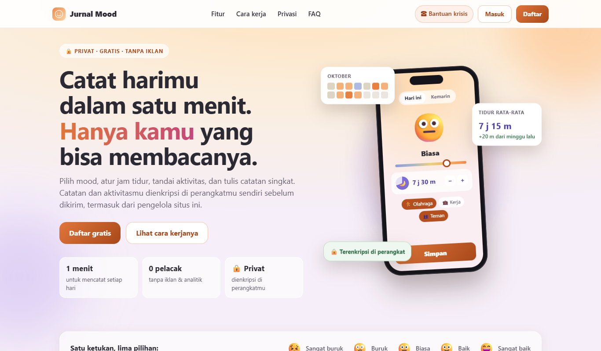
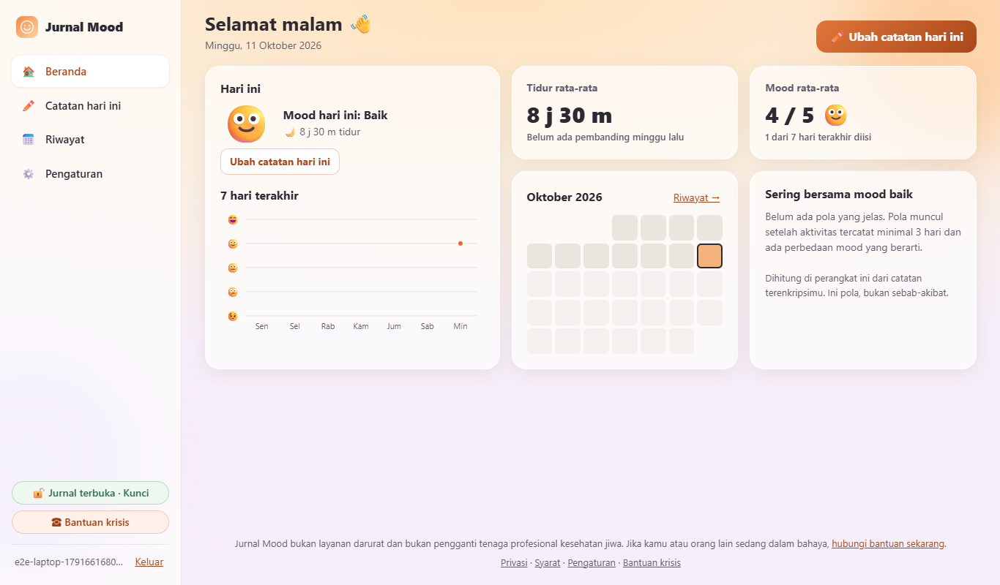
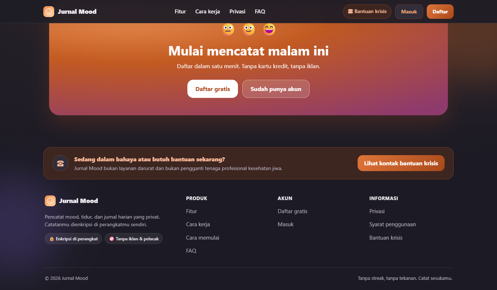

# Jurnal Mood

Pencatat mood, tidur, dan jurnal harian yang **privat**. Catatan dan aktivitas dienkripsi di
browser pengguna sebelum dikirim, jadi pengelola server, hosting, dan backup tidak bisa membacanya.
Dibuat untuk komunitas kecil, dengan alur harian di bawah satu menit dari HP.

> **Bukan layanan darurat** dan bukan pengganti tenaga profesional kesehatan jiwa. Setiap halaman
> menampilkan tautan bantuan krisis.

<p align="center">
  
  
</p>
<p align="center">
  
  
</p>

## Fitur

- **Catat dalam semenit**: mood 1–5 dengan wajah, jam tidur ± 30 menit, chip aktivitas, catatan opsional.
  Satu entri per hari, bisa diubah, bisa mengisi untuk kemarin. Draf tersimpan terenkripsi.
- **Beranda dan riwayat**: ringkasan 7 hari, kalender mood berwarna, grafik mood dan tidur
  (minggu, bulan, setahun), dan pola aktivitas di hari baik yang dihitung di perangkat.
- **Kunci pemulihan**: kode 24 karakter yang dibuat saat membuat jurnal, untuk membuka catatan
  jika passphrase terlupa. Bisa dibuat ulang dari Pengaturan.
- **Ekspor data** ke JSON atau CSV, dibuat di perangkat setelah jurnal dibuka.
- **Pengingat harian** opsional lewat Web Push, dan bisa dipasang sebagai aplikasi (PWA).
- **Responsif**: sidebar di laptop dan iPad lanskap, tab bar di HP, mode gelap otomatis.
- **Perintah pengelola lewat CLI**, tanpa panel admin web.

## Privasi dan keamanan

| Data | Disimpan sebagai | Bisa dilihat pengelola? |
|---|---|---|
| Teks catatan, aktivitas, daftar aktivitas buatan sendiri, draf | Terenkripsi AES-256-GCM di browser | Tidak |
| Skor mood 1–5, jam tidur, tanggal entri | Teks biasa (agar grafik bisa dibuat) | Ya |
| Email akun, ukuran data, waktu akses | Teks biasa | Ya |

Cara kerjanya:

- Setiap pengguna punya **passphrase jurnal** yang terpisah dari password login dan **tidak pernah dikirim** ke server.
- Data dienkripsi dengan kunci acak (DEK). DEK itu dibungkus oleh kunci yang diturunkan dari passphrase
  memakai PBKDF2-SHA256 600.000 iterasi.
- Setiap entri memakai IV acak, dan ciphertext diikat ke pengguna serta tanggalnya (AAD).
- DEK hanya ada di memori tab sebagai kunci yang tidak bisa diekspor, dan jurnal terkunci otomatis
  setelah 15 menit tanpa aktivitas.
- Password login di-hash dengan Argon2id. Sesi disimpan sebagai hash token, dan cookie memakai awalan `__Host-` di produksi.
- Proteksi CSRF dan pemeriksaan Origin, plus **CSP ketat**: tanpa skrip atau gaya inline dan tanpa CDN.
  Tes otomatis memastikan template tidak berisi skrip, gaya, atau handler inline.

Batasan yang diakui terus terang: JavaScript enkripsi dikirim oleh server, jadi pengguna tetap harus
memercayai server yang mengirim kode tersebut. Penjelasan lengkap ada di halaman `/privasi` aplikasi
dan di [docs/SPEC.md](docs/SPEC.md).

## Keselamatan pengguna

- Tautan **Bantuan krisis** selalu terlihat. Daftar kontaknya diatur di `config/crisis.yaml`.
- Setelah 3 hari berturut-turut dengan mood rendah, muncul kartu pesan yang lembut. Kartu ini dihitung
  di browser, bisa ditutup, dan tidak dicatat di server.
- Tidak ada alarm otomatis, label diagnosis, penguncian akun, atau tekanan streak.

## Teknologi

| Bagian | Teknologi |
|---|---|
| Server | Go 1.27, [chi](https://github.com/go-chi/chi), [pgx](https://github.com/jackc/pgx), migrasi [goose](https://github.com/pressly/goose) (embed) |
| Database | PostgreSQL 14+ |
| Tampilan | Go `html/template`, [htmx](https://htmx.org) (`hx-boost`), CSS dan JavaScript modul tanpa build step |
| Kripto | Web Crypto API (PBKDF2, AES-GCM), Argon2id di server |
| Tes | `go test`, `node --test`, Playwright (HP, iPad potret dan lanskap, laptop) |
| Deploy | Docker (distroless, non-root), Docker Compose, Caddy (HTTPS otomatis), backup harian |

## Struktur folder

```
cmd/server/          titik masuk server + perintah CLI (invite, vapid, admin, healthcheck)
internal/
  auth/              akun, sesi, password, undangan, batas pendaftaran
  journal/           bungkus kunci jurnal + kunci pemulihan
  entries/           entri harian (mood/tidur polos, catatan terenkripsi)
  reminders/         langganan dan pengiriman Web Push
  admin/             statistik dan operasi pengelola
  migrations/        skema SQL (di-embed ke binary)
  web/               router, handler, middleware keamanan, render template
web/
  templates/         layout dan halaman
  static/            CSS, JavaScript (crypto, form, grafik, kalender), ikon, htmx
config/              contoh kontak krisis
deploy/              compose.yaml, Caddyfile, contoh .env produksi
docs/                SPEC, PLAN, panduan DEPLOY
scripts/             dev.sh (pengembangan) dan smoke.sh (cek pasca-deploy)
tests/               tes JavaScript dan end-to-end
```

## Menjalankan secara lokal

Yang dibutuhkan: **Go 1.27+**, **PostgreSQL 14+**, dan **Node.js 20+** (hanya untuk tes JS dan e2e).

```bash
# 1. Database
createdb moodjournal

# 2. Konfigurasi
cp .env.example .env                 # sesuaikan DATABASE_URL bila perlu
cp config/crisis.example.yaml config/crisis.yaml   # isi kontak krisis yang sudah diverifikasi

# 3. Jalankan (migrasi berjalan otomatis saat start)
go run ./cmd/server
# buka http://127.0.0.1:8080
```

**Pengguna Windows:** jika Smart App Control memblokir program Go, jalankan server dan tes di WSL (Ubuntu)
dengan `networkingMode=mirrored` di `%USERPROFILE%\.wslconfig`, lalu pakai skrip bantu:

```bash
wsl -d Ubuntu -- bash scripts/dev.sh run     # server
wsl -d Ubuntu -- bash scripts/dev.sh test    # gofmt + vet + tes Go
```

## Konfigurasi

Semua lewat environment variable atau file `.env` (lihat [.env.example](.env.example)).

| Variabel | Bawaan | Keterangan |
|---|---|---|
| `DATABASE_URL` | – | URL koneksi PostgreSQL (wajib) |
| `ADDR` | `127.0.0.1:8080` | Alamat server |
| `APP_ENV` | `development` | `production` mengaktifkan HSTS, cookie `__Host-`, dan cache statis |
| `REGISTRATION` | `open` | `open` (dibatasi per IP) atau `invite` (wajib kode undangan) |
| `SIGNUP_LIMIT_PER_HOUR` | `5` | Batas pendaftaran per IP per jam |
| `TRUST_PROXY` | `false` | `true` jika berada di belakang reverse proxy (Caddy) |
| `CRISIS_FILE` | `config/crisis.yaml` | Daftar kontak bantuan krisis |
| `OPERATOR_NAME`, `OPERATOR_CONTACT` | – | Identitas pengelola di halaman Privasi dan Syarat. **Isi sebelum dipakai orang lain.** |
| `MIN_AGE` | `18` | Usia minimum pengguna (13–25) |
| `VAPID_PUBLIC_KEY`, `VAPID_PRIVATE_KEY`, `VAPID_SUBJECT` | – | Pengingat Web Push (opsional). Buat dengan `go run ./cmd/server vapid` |

## Tes

```bash
go test -p 1 ./...                   # butuh TEST_DATABASE_URL (database khusus tes, akan dikosongkan)
npm ci
npm run test:js                      # tes JavaScript (kripto, logika form, ekspor)
npm run e2e                          # Playwright + Chrome, butuh server e2e di port 8090
                                     # (bash scripts/dev.sh e2e-server)
```

## Deploy

Panduan lengkap untuk satu VPS (Docker Compose, Caddy, backup, restore, update, dan checklist) ada di
**[docs/DEPLOY.md](docs/DEPLOY.md)**. Ringkasnya:

```bash
cd deploy
cp .env.prod.example .env.prod       # isi DOMAIN, DB_PASSWORD, OPERATOR_*, dll.
docker compose --env-file .env.prod up -d --build
bash ../scripts/smoke.sh https://domain-anda   # cek HTTPS, header keamanan, dan kesehatan aplikasi
```

## Perintah pengelola

```bash
docker compose exec app /app/moodjournal admin stats
docker compose exec app /app/moodjournal admin recent-signups -hari 7
docker compose exec app /app/moodjournal admin reset-password <email>
docker compose exec app /app/moodjournal admin delete-user <email> -ya
docker compose exec app /app/moodjournal invite -hari 7   # kode undangan 7 hari (mode invite)
```

Mereset password login **tidak** membuka catatan, karena passphrase jurnal tetap hanya diketahui pengguna.

## Dokumentasi

- [docs/SPEC.md](docs/SPEC.md): semua keputusan produk, privasi, dan keselamatan
- [docs/PLAN.md](docs/PLAN.md): rencana implementasi bertahap
- [docs/DEPLOY.md](docs/DEPLOY.md): panduan deploy dan operasional

## Lisensi

Belum ditentukan. Semua hak dilindungi sampai file `LICENSE` ditambahkan.
